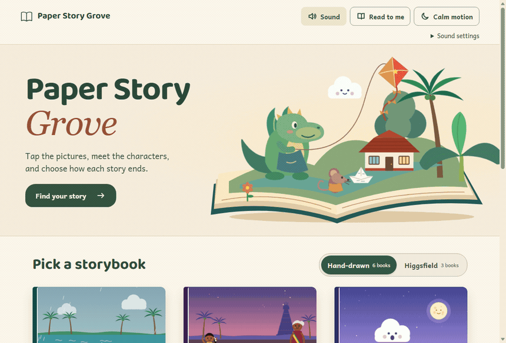
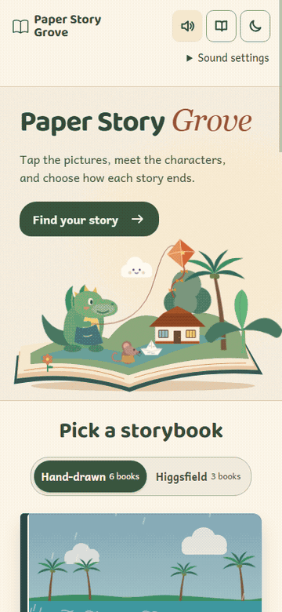

# Paper Story Grove

Six interactive picture books in English for young children and the grown-ups reading with them. Chase a paper boat through the Kerala backwaters, make room for a cousin at an Onam feast, or help a dragon mend the kite he tore with a sneeze. Each story pauses for a choice, and each choice leads to its own ending.

[Open Paper Story Grove on GitHub Pages](https://brej-29.github.io/Paper-Story-Grove/)



## Choose an edition

**Hand-drawn** opens by default with all six books. The pictures are built from layers of cut-paper-style SVG art. Rain falls, lamps flicker, and a kite tugs at its string. Touch a character or an object to discover what it does.

**Higgsfield** opens a shelf of three books featuring Anu, Dev and Moss. Each of their 24 illustrated pages has its own painting. Twelve also have a short, silent animated clip that can be replayed. The words, choices and endings are shared with the hand-drawn edition.

<p align="center">
  
  <br><em>On a phone, Anu’s painting sits above the words. Tap the last lamp for a little welcome.</em>
</p>

## On the shelf

| Book | What your child gets to decide | Editions |
| --- | --- | --- |
| **Ammu and the Monsoon Boat** | Follow a drifting paper boat into the lily channel or out onto the lake where the drums are playing. | Hand-drawn |
| **Meenu and the Morning Kolam** | Finish the doorstep pattern with a peacock or a sun. | Hand-drawn |
| **Puff, the Sleepy Little Cloud** | Find Puff a bed on the moon or settle the little cloud on a hill. | Hand-drawn |
| **Anu and the Last Little Lamp** | Welcome a neighbour home with a light beside the door or a place in the courtyard. | Both |
| **Dev and the Extra Banana Leaf** | Make room at the feast with one long row of banana leaves or two rows facing each other. | Both |
| **Moss and the Kite That Sneezed** | Help Moss and Mouse turn a torn kite into a ribbon-tailed comet or a paper bird. | Both |

## Read together

- **Explore a picture.** Tap a detail, or focus it with Tab and press Enter or Space. A caption appears even with the sound off. Press the star counter for a hint.
- **Turn the page.** Use the round arrows, the left and right arrow keys, or a horizontal swipe. At an ending, **Try the other way** returns to the choice. **All stories** takes you back to the shelf.
- **Listen or read aloud yourself.** **Read to me** narrates each page when a supported English voice is available. Open **Read aloud controls** to pause, replay, or adjust the speed. **Sound** controls music and effects separately.
- **Settle in for a quiet read.** **Calm motion** stills the illustrations and softens page turns. It starts on when the device requests reduced motion.
- **Explore the setting.** Open **A note for grown-ups** on the shelf for story-specific context, including the doorstep kolam in Meenu’s book, the clay lamps in Anu’s, and the banana-leaf feast in Dev’s. The characters and their adventures are fictional. [Background on Karthigai Deepam and Onam sadya](docs/replacement-stories.md)

The browser remembers the selected edition, endings and discoveries on this device when local storage is available. Endings count across editions of the same book. Each edition keeps its own picture discoveries. Narration uses local voices by default. Turning on **Allow online browser voices** lets a voice provider receive the text it reads.

## Run locally

The reader is a static site with bundled art, clips and fonts. With Node.js installed, run these commands from a terminal.

```sh
git clone https://github.com/brej-29/Paper-Story-Grove.git
cd Paper-Story-Grove
node tests/serve.cjs
```

Open [the local reader](http://127.0.0.1:8000/). Any static server can serve the repository root, including GitHub Pages. There is no package installation or build step.

## How the books work

| Files | Role |
| --- | --- |
| `index.html`, `styles.css`, `js/app.js` | Shelf, edition switch, reader, grown-ups note, accessibility controls and saved progress |
| `js/art.js`, `js/stories.js` | Original drawing kit and the Ammu, Meenu and Puff stories |
| `js/story-*-new.js`, `js/paper-scenes.js` | Anu, Dev and Moss story text, branches, hand-drawn scenes and discoveries |
| `js/illustration.js`, `assets/stories/` | Higgsfield paintings, discovery locations and clips |
| `js/living.js`, `js/living-pages.js` | Painted-page motion, paragraph focus and clip playback |
| `js/sound.js`, `js/narration.js` | Synthesised music and effects, voice selection and page narration |

Each story supplies its own pages, scene layers, choices and endings. To add a book, append its definition to `STORIES` in a separate script and load it before `js/app.js`. Hand-drawn scenes return SVG layers from back to front. The drawing kit’s `F` helper gives an object its accessible name, caption, sound, tap animation and hit area.

For painted-page motion, open the local reader with `?living=edit` and use the numbered regions to tune `js/living-pages.js` in the painting’s 800 × 600 coordinate system. The optional clip preparation script aligns a local video with its painting and encodes a silent H.264 clip using FFmpeg. [Page artwork and provenance](docs/page-illustrations.md) · [Narration notes](docs/narration.md)

## Checks

Run the following from the repository root with Node.js.

```sh
node tests/content.cjs
node tests/app.cjs
node tests/navigation.cjs
node tests/preservation.cjs
node tests/page-art.cjs
node tests/living.cjs
node tests/narration.cjs
node tests/read-aloud-stories.cjs
node tests/sound.cjs
```

With the local server running, `node tests/http.cjs` also checks that the reader’s scripts, fonts, paintings and clips are served successfully.

## Licence

Project code and artwork are distributed under the [MIT licence](LICENSE). The bundled Baloo 2 and Andika fonts use the SIL Open Font License.
