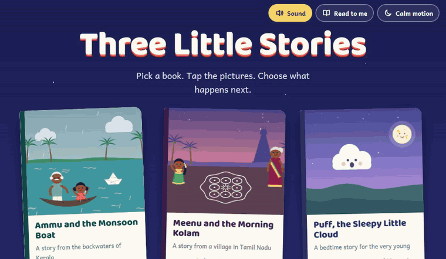
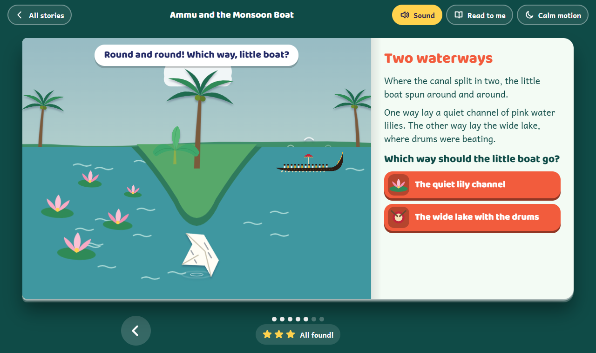
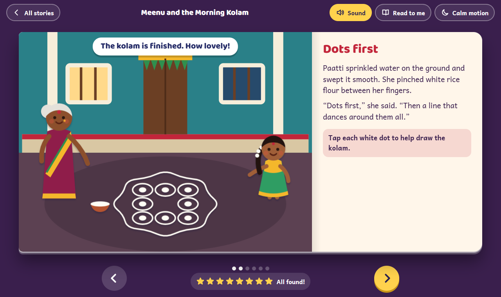
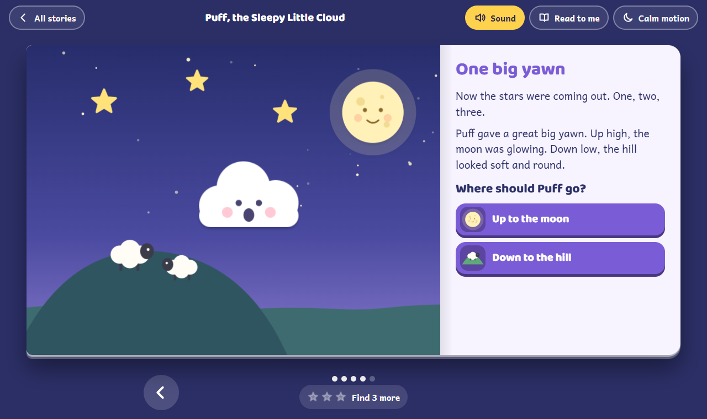
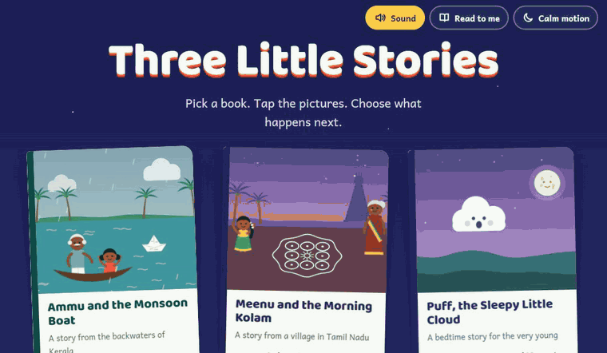
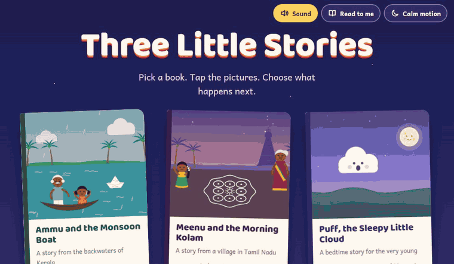
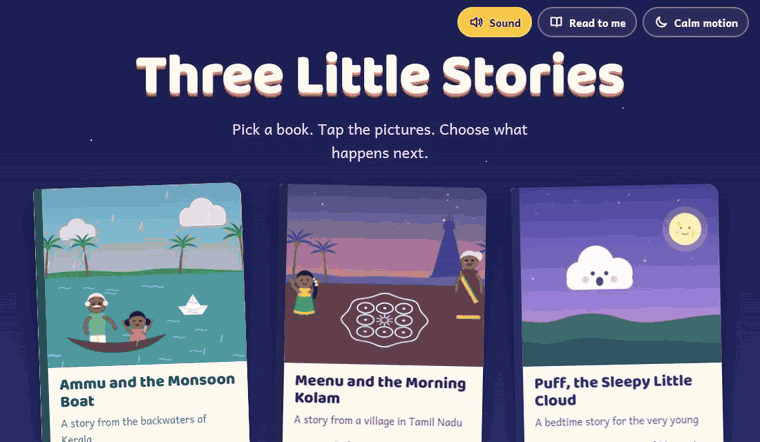
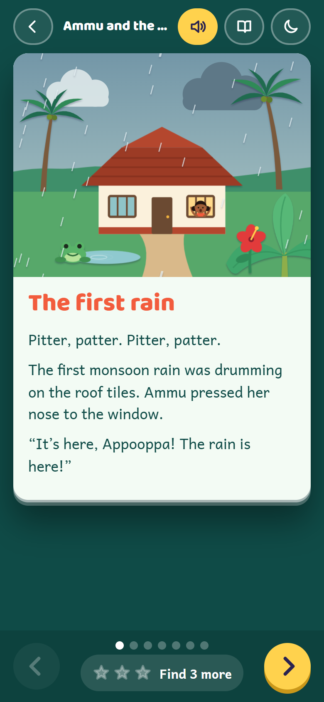

<div align="center">

# Three Little Stories

**Interactive pop-up picture books for young children, to read together.**

A monsoon boat in Kerala. A morning kolam in Tamil Nadu. A little cloud who cannot sleep.

[](https://brej-29.github.io/Three-Little-Stories/)

[](LICENSE)
[](#how-it-is-made)
[](#run-it-locally)
[](#how-it-is-made)



</div>

Three original stories, each with layered paper-cut scenes that pop up as the page turns, things to tap in every picture, one big choice, and two different endings. Nothing to install and nothing to sign up for. It works without sound and without motion, and it never needs the internet once loaded.

| | |
|---|---|
| **Read it** | <https://brej-29.github.io/Three-Little-Stories/> |
| **For** | Young children with a grown-up (I assumed roughly ages 3 to 8) |
| **Books** | 3 stories, 23 illustrated pages, 6 endings, 76 surprises to find |
| **Language** | English |
| **Tech** | Plain HTML, CSS and JavaScript. SVG art, Web Audio sound |

## The books

| | Book | Setting | The choice | Endings |
|---|---|---|---|---|
|  | **Ammu and the Monsoon Boat** | The Kerala backwaters in the first rain | Follow the paper boat down the quiet lily channel, or out to the wide lake with the drums | The otters' boat, The snake boat race |
|  | **Meenu and the Morning Kolam** | A Tamil Nadu village before sunrise | Draw a peacock or a sun in the middle of the kolam | The rain dance, Pongal morning |
|  | **Puff, the Sleepy Little Cloud** | A bedtime story for the very young | Sleep up on the moon or down on the hill | A bed on the moon, A blanket for the hill |

<table>
  <tr>
    <td width="50%"></td>
    <td width="50%"></td>
  </tr>
  <tr>
    <td align="center"><sub>Every picture hides things to tap. Each one answers with a sound and a caption.</sub></td>
    <td align="center"><sub>In the kolam story the child draws the pattern by tapping each dot.</sub></td>
  </tr>
  <tr>
    <td></td>
    <td align="center"></td>
  </tr>
  <tr>
    <td align="center"><sub>Each book stops once and asks what happens next.</sub></td>
    <td align="center"><sub>On phones the picture sits above the words.</sub></td>
  </tr>
</table>

## How to read

- Tap or click things in the picture. A star counter under each page shows how many surprises you have found. Press it for a hint.
- Turn pages with the round arrow buttons, the left and right arrow keys, or a swipe. `Esc` goes back to the shelf.
- At the choice page, pick a button. After the ending, **Try the other way** goes back to the choice.
- Finished endings and found surprises are saved in your browser, so the shelf remembers what you have discovered. Nothing leaves your device.

## Controls and access

| Control | What it does |
|---|---|
| **Sound** | Music and sound effects on or off |
| **Read to me** | Reads each page aloud with your browser's built-in speech voice. Hidden if your browser has none |
| **Calm motion** | Stops all moving pictures and swaps the page flip for a quick fade. On by default if your device asks for reduced motion |

- **Works without audio.** Every sound effect also appears as words in a caption on the picture.
- **Keyboard complete.** Every tappable thing can be reached with `Tab` and used with `Enter` or `Space`, with a visible focus ring.
- **Big targets.** Tap areas are larger than the drawings, and buttons are at least 44 px.
- **Screen readers.** Pictures, surprises and the page counter have text labels.

## About the stories

The stories are original. The characters and events are invented. They draw on real places and customs, and I tried to be specific rather than generic. The shelf has a **note for grown-ups** that explains the words used.

| Word | Meaning here |
|---|---|
| Appooppan, Ammukutty | Malayalam for grandfather, and an affectionate way to say "little Ammu" |
| Kettuvallam | A traditional Kerala houseboat with a woven roof |
| Chundan vallam | The long snake boat rowed in Kerala's boat races, where rowers keep time with boat songs |
| Ponman, ambal | Malayalam names for the kingfisher and the water lily |
| Kolam | A pattern drawn at the doorstep in Tamil Nadu, traditionally with rice flour and often around a grid of dots. The drawing in the book is a simplified one, not a specific traditional design |
| Paatti, kanna | Tamil for grandmother, and a term of endearment |
| Mayil | Tamil for peacock |
| Pongal | The harvest festival where a pot of rice and milk is left to boil over, with the call "Pongalo Pongal!". The following day is traditionally for cattle |

These notes come from general knowledge and have not been reviewed by Malayalam or Tamil speakers. Please open an issue with corrections.

## How it is made

- **Art.** Every picture is drawn in code as layered SVG "paper cut" scenes. Layers pop up in sequence, drift slightly with the pointer, and cast soft shadows. The drawing kit (people, animals, boats, plants, a kolam builder) is in `js/art.js`. No image files, no image-generation service.
- **Sound.** All music and effects are synthesised live with the Web Audio API. Each book has its own tune and mood. There are no audio files.
- **Page turning.** A 3D page flip in CSS, with a fade when Calm motion is on.
- **Fonts.** Baloo 2 and Andika are bundled in `fonts/` under the SIL Open Font License.
- **Offline and private.** No frameworks, no analytics, no external requests.

## Run it locally

No install and no build step.

```bash
git clone https://github.com/brej-29/Three-Little-Stories.git
cd Three-Little-Stories
python -m http.server 8000      # or any static server
```

Then open <http://localhost:8000>. Opening `index.html` directly also works.

It was tested in Microsoft Edge (Chromium). Other browsers should work but have not been tested, and swipe on a real touch device has not been tried.

## Project layout

| Path | Purpose |
|---|---|
| `index.html` | Page shell, controls, SEO tags |
| `styles.css` | Layout, page turning, animations, calm-motion rules |
| `js/art.js` | Drawing kit |
| `js/stories.js` | Story text, scenes, choices and the grown-ups note |
| `js/sound.js` | Synthesised music and effects |
| `js/app.js` | Shelf, reader, progress, keyboard and touch |
| `docs/media/` | README screenshots and GIFs |

### Add a story

Add an entry to `STORIES` in `js/stories.js`. A story has `pages` with `text`, a `scene()` that returns SVG layers (back to front), an optional `choice`, and `end` on the final pages. Wrap anything tappable in `F(id, label, caption, sound, animation, svg, hitArea)`. Sound names are listed in `js/sound.js`.

## Deploy your own copy

It is a static site. For GitHub Pages, set **Settings, Pages, Source** to the `main` branch and the root folder. Any static host works.

## Licence

- **Code and artwork:** [MIT](LICENSE).
- **Fonts:** Baloo 2 and Andika, SIL Open Font License.
